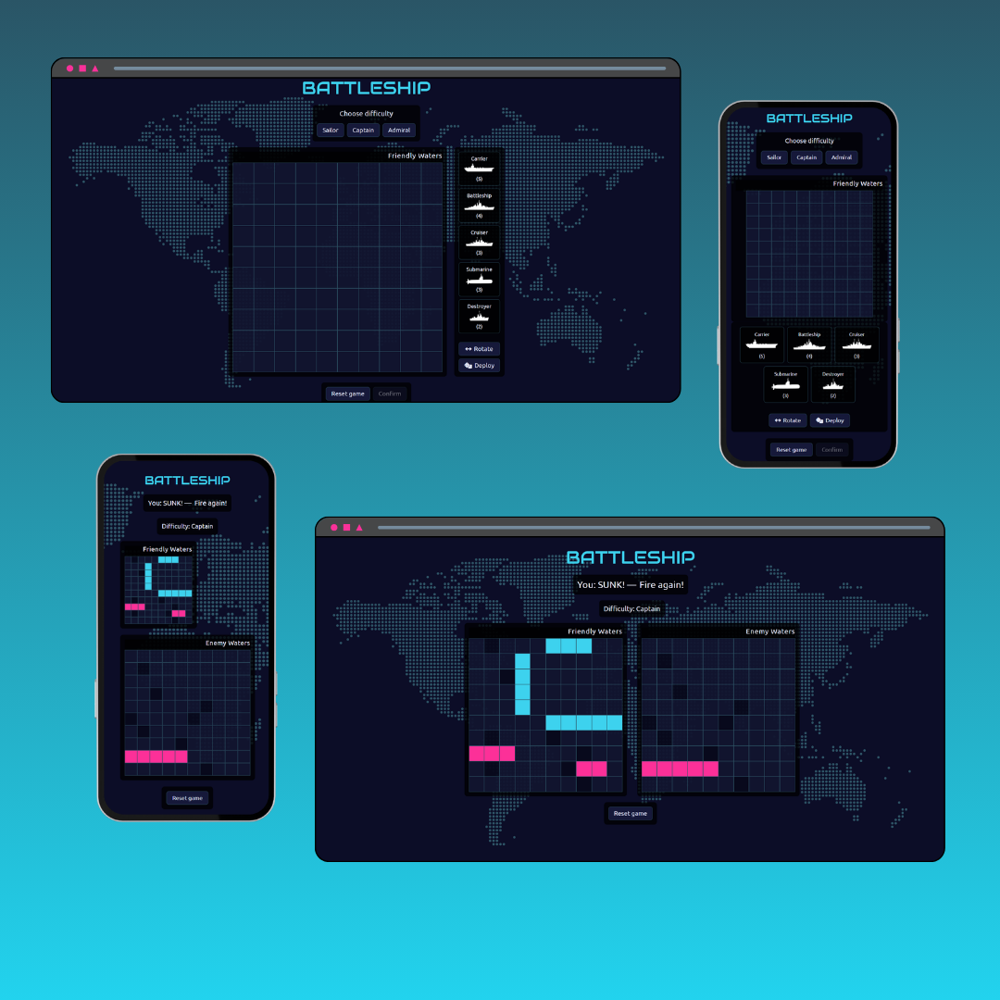

# ⚓ Battleship

A classic Battleship game against a computer opponent, built with vanilla JavaScript, bundled with Webpack, and driven by a test-first game engine. Place your fleet, pick a difficulty, and sink the enemy — on desktop or mobile.

> Built as part of [The Odin Project](https://www.theodinproject.com/) curriculum.

## 🔗 Live Demo

**[Play Battleship →](https://orianaland.github.io/Battleship/)**

## Key Features

- **Drag-and-drop ship placement** — drag your fleet onto the board, rotate between horizontal/vertical, or auto-place at random.
- **Three difficulty levels** — Sailor, Captain and Admiral, backed by a smart CPU that hunts and targets instead of firing blindly.
- **Responsive, mobile-first** — a single layout that works with both touch and mouse.
- **Themed naval UI** — dotted world-map backdrop, neon accents, and custom typography.
- **Live combat feedback** — concise hit / miss / sunk messages with turn tracking.
- **Victory & defeat screens** — a clear end to every battle.

## Screenshots



## Technologies Used

- **Language & markup:** JavaScript (ES6 modules), HTML5, CSS3
- **Testing:** Jest — the game engine is covered by unit tests, written test-first
- **Build tool:** Webpack (module bundling + asset pipeline)
- **Interaction:** Pointer Events API for drag-and-drop (touch + mouse)
- **UI:** Font Awesome (icons) · Google Fonts (Ubuntu + Audiowide)
- **Deployment:** GitHub Pages (`gh-pages`)

## Architecture

The code keeps game logic separate from the DOM:

- **Model (`src/modules/classes`)** — `Ship`, `Gameboard`, `Player`, `Game`: pure game rules and state with no DOM access, so they're fully unit-testable.
- **CPU AI (`Player`)** — a hunt-and-target algorithm: after a hit it probes adjacent cells, and on Admiral it locks onto the ship's axis once it lands a second hit.
- **Views (`src/views`)** — `SetupView` (placement + drag-and-drop) and `GameView` (boards + messages) handle all rendering.
- **Controller (`GameController`)** — orchestrates the flow: setup → play → game over.

## Testing

The game engine is driven by Jest unit tests across the `Ship`, `Gameboard`, `Player` and `Game` classes.

```bash
npm test
```

## What I Practiced

- OOP with ES6 classes and private fields, with a clean model / view / controller separation
- Test-driven development with Jest
- Designing a game AI (hunt & target with difficulty tiers)
- Drag-and-drop with the Pointer Events API, working across touch and mouse
- Responsive, mobile-first CSS (Grid, Flexbox, `clamp()`, `@media (hover)`)
- A disciplined git workflow — feature branches and conventional commits

## How to Play

1. **Place your fleet** — drag each ship onto your board; use the rotate button to change orientation, or hit random for an auto-layout.
2. **Choose a difficulty** and confirm to start.
3. **Fire** by clicking the enemy's waters — a hit lets you fire again; a miss passes the turn.
4. **Sink all enemy ships** to win.

## Installation & Local Development

```bash
# Clone the repository
git clone https://github.com/OrianaLand/Battleship.git
cd Battleship

# Install dependencies
npm install

# Start the dev server
npm run dev
```

Then open **http://localhost:8080**.

Other scripts:

```bash
npm test          # run the Jest test suite
npm run build     # production build to /dist
npm run deploy    # publish /dist to GitHub Pages
```

## License

Open source under the ISC License.

## Contact

Oriana — [LinkedIn](https://linkedin.com/in/oriana-landaeta) — landaetaoriana@gmail.com

Project link: [github.com/OrianaLand/Battleship](https://github.com/OrianaLand/Battleship)
